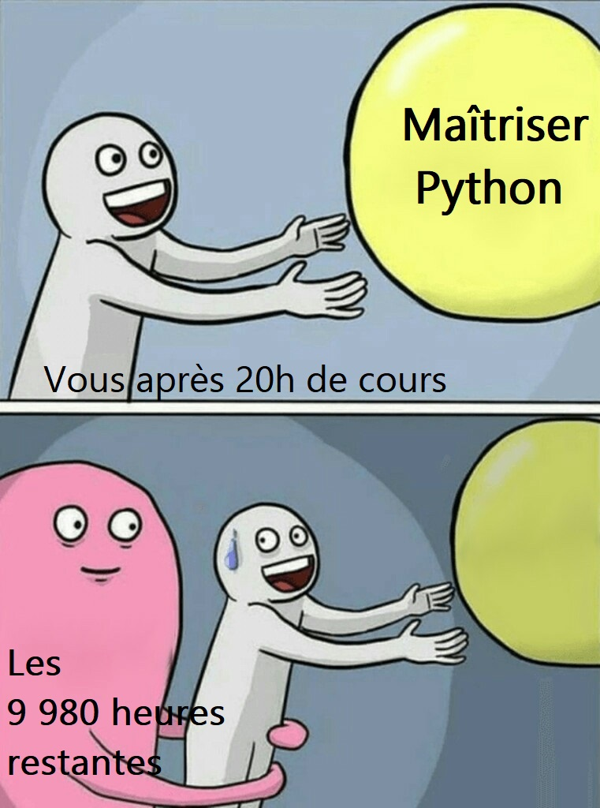

Bienvenue dans ce module d'introduction à la programmation `Python`.

Il est conçu pour des **débutants complets** : aucune connaissance préalable en programmation n'est nécessaire. À la fin du module, vous saurez écrire de petits programmes qui manipulent des données, et vous aurez les bases pour aborder l'analyse de données.

## Au programme

| | Chapitre | Ce que vous apprendrez |
|---|---|---|
| 0 | [Premiers pas dans un notebook](00-premiers-pas-notebooks.qmd) | Prendre en main l'outil de travail : cellules, exécution, Markdown |
| 1 | [Variables, types et opérations](01-variables-types-operations.qmd) | Nommer des valeurs, comprendre ce qui se passe en mémoire, calculer et manipuler du texte |
| 2 | [Conditions et boucles](02-conditions-boucles.qmd) | Prendre des décisions et répéter des actions |
| 3 | [Structures de données](03-structures-donnees.qmd) | Regrouper des valeurs dans des listes, tuples, dictionnaires et ensembles |
| 4 | [Le slicing](04-slicing.qmd) | Extraire une portion d'une liste ou d'une chaîne |
| 5 | [Les fonctions](05-fonctions.qmd) | Organiser son code en blocs réutilisables, et distinguer fonctions et méthodes |
| 6 | [Erreurs et exceptions](06-erreurs-exceptions.qmd) | Apprendre à lire les erreurs et créer ses propres exceptions |
| 7 | [Scripts et jeux](07-scripts-jeux.qmd)| Sortir du notebook, dialoguer avec l'utilisateur et coder des jeux classiques pour débuter l'algorithmie |

Chaque chapitre s'appuie sur les précédents : suivez-les **dans l'ordre**, via la barre latérale ou les liens en bas de chaque page.

## Comment ce module est organisé

Chaque chapitre se compose de deux parties.

**Une page de cours**, sur ce site, qui contient :

- des **explications** illustrées d'exemples concrets ;
- des encadrés **🧠 À vous de réfléchir** : un petit code à analyser *avant* de l'exécuter, avec sa solution repliée. Jouez le jeu, c'est là que se trouvent les pièges les plus fréquents ;
- un encadré **À retenir** en fin de page.

Chaque page est aussi disponible en **slides**, via le lien « Voir les slides ».

**Un notebook d'exercices**, accessible en haut de chaque page de cours, avec :

- des cellules `# TODO` à compléter, et le résultat attendu pour vous vérifier ;
- un mini-projet en fin de notebook, qui combine les notions du chapitre ;
- des **corrigés** à consulter *après* avoir cherché.

::: {.callout-tip}
## Où travailler ?
Nous utiliserons principalement **SSP Cloud** ou **Google Colab** : ils sont préconfigurés et ne nécessitent aucune installation. Ils sont présentés dans la partie [Environnement](../02-environnement/index.qmd).

En haut de chaque page de cours, deux boutons ouvrent directement le notebook d'exercices :

(ceux-ci sont des exemples et ne mènent à aucun notebook 👀)
:::

::: {.callout-tip}
## L'erreur est normale
Se tromper fait partie de l'apprentissage. Lisez les messages d'erreur : ils indiquent la ligne en cause et le type de problème, et vous apprendrez vite à les déchiffrer.
:::

::: {.callout-tip}
## Un cours dense : c'est normal de ne pas tout retenir
Ce cours contient beaucoup d'informations, pour peu d'heures en classe. Ne vous inquiétez pas si tout ne rentre pas du premier coup : à chaque relecture, vous découvrirez des détails qui vous avaient échappé : c'est aussi comme ça que l'on apprend.

On dit souvent qu'il faut environ **10 000 heures** de pratique pour devenir expert dans un domaine. Le chiffre est discutable, mais l'idée est juste : ce n'est pas avec une vingtaine d'heures de cours que l'on maîtrise un langage. Ce cours vous donne les bases ; la suite se construit en **pratiquant régulièrement**, sur vos propres projets ou sur des exercices d'algorithmique.

Quelques sites pour continuer à vous entraîner :

- [France-IOI](https://www.france-ioi.org/) : des exercices d'algorithmique progressifs, en français, idéal pour débuter ;
- [Codewars](https://www.codewars.com/) : de petits défis classés par niveau, à résoudre dans le navigateur ;
- [CodinGame](https://www.codingame.com/) : des puzzles et des jeux où vous programmez des robots qui s'affrontent ;
- [Advent of Code](https://adventofcode.com/) : un calendrier de l'Avent de casse-têtes, du 1er au 25 décembre, avec des archives de toutes les années précédentes ;
- [LeetCode](https://leetcode.com/) : les exercices utilisés dans les entretiens techniques, pour aller plus loin ;
- [DataCamp](https://www.datacamp.com/) : des cours interactifs orientés data (une partie est payante).

Le meilleur exercice reste un **projet qui vous intéresse** : analyser les données de votre sport préféré, automatiser une tâche répétitive au travail… On apprend beaucoup plus vite quand on veut vraiment obtenir le résultat.
:::

{width=40% fig-align="center"}

## Ressources

- [GitHub du cours](https://github.com/surybang/python_data)
- [Galiana, Lino. *Python pour la data science*.](https://doi.org/10.5281/zenodo.8229676)
- [Chaîne YouTube Machine Learnia](https://www.youtube.com/c/MachineLearnia)
- [Chaîne YouTube de Ricco Rakotomalala](https://www.youtube.com/@master2sisedatascience)
