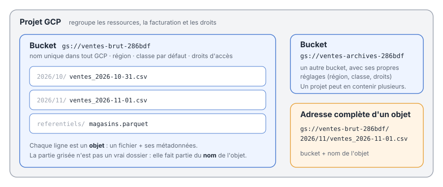
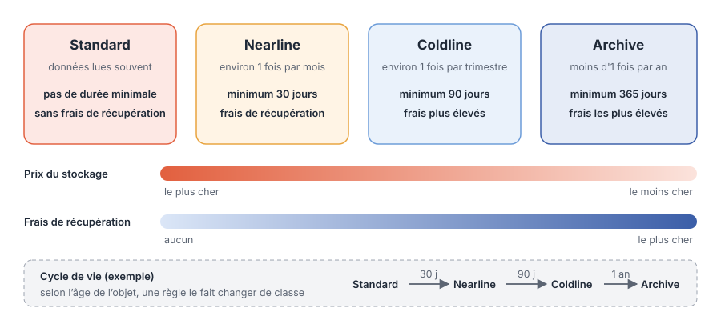

Dans la page sur les bases de données, nous avons vu que beaucoup de données analytiques vivent dans des **fichiers** (CSV, Parquet) posés sur un **stockage objet**, comme S3 chez Amazon ou MinIO sur SSP Cloud. Sur Google Cloud, ce service s'appelle **Cloud Storage**, souvent abrégé **GCS** (*Google Cloud Storage*). C'est la première brique de presque tout projet data sur GCP : c'est là qu'arrivent les fichiers bruts, avant d'être chargés dans BigQuery ou traités par un programme.

## Le stockage objet, c'est quoi ?

Cloud Storage n'est ni un disque dur, ni une base de données. Il stocke des **objets** : un objet, c'est un fichier (de n'importe quel type et de n'importe quelle taille) accompagné de quelques **métadonnées** (sa taille, son type, sa date de création…).

| | Disque dur | Base de données | Stockage objet (GCS) |
|---|---|---|---|
| On y range | des fichiers dans des dossiers | des lignes dans des tables | des fichiers entiers (objets) |
| On y accède | depuis une seule machine | en SQL | depuis n'importe où, par une adresse |
| Capacité | limitée par le disque | limitée par le serveur | pratiquement illimitée |
| Coût | acheté d'avance | selon le serveur | à l'usage : ce qu'on stocke et ce qu'on lit |

On ne modifie pas un objet ligne par ligne comme une table : on le **dépose**, on le **lit** ou on le **remplace** entièrement.

On y range à peu près tout ce qui prend la forme d'un fichier : les données brutes directement extraites des applications sources, des **jeux de données** (CSV, Parquet), des **modèles** de machine learning entraînés, des **logs**, des sauvegardes, des images… Et surtout, les autres services de Google Cloud savent **lire directement** dans Cloud Storage : BigQuery peut charger ou interroger des fichiers posés dans un bucket par exemple. GCS devient ainsi le point de rencontre des données entre les services.


:::{.callout-note}
## GCS, un data lake ?
Cloud Storage est souvent le **socle** d'un data lake sur Google Cloud, mais un bucket n'en est pas un à lui seul. Un data lake, c'est une **façon d'organiser** le stockage pour l'analyse : on y conserve les données brutes de toutes les sources, dans des formats ouverts (Parquet, CSV, JSON), rangées par zones (brut, nettoyé, prêt à l'emploi), décrites dans un **catalogue** et interrogées par des moteurs comme BigQuery, Spark ou DuckDB.

Sans cette organisation, on obtient ce qu'on surnomme un *data swamp*, un marécage de données : tout est stocké, mais personne ne sait ce qu'il y a, d'où ça vient, ni si c'est fiable.
:::

## Projets, buckets et objets

Cloud Storage s'organise en trois niveaux :

- le **projet GCP** regroupe toutes les ressources, la facturation et les droits ;
- un **bucket** (littéralement « seau ») est un conteneur d'objets, avec ses propres réglages : son emplacement, sa classe de stockage par défaut, ses droits d'accès ;
- les **objets** sont les fichiers rangés dans un bucket.

{fig-alt="Schéma de l'organisation de Cloud Storage : projet, buckets, objets" width="100%"}

Chaque objet a une adresse qui commence par `gs://`, suivie du nom du bucket puis du nom de l'objet :

```
gs://ventes-brut-286bdf/2026/11/ventes_2026-11-01.csv
```

:::{.callout-note}
## Les dossiers n'existent pas vraiment
Dans un bucket classique, `2026/11/` n'est pas un vrai dossier : c'est simplement le **début du nom** de l'objet. La console et les outils affichent une arborescence pour que ce soit plus lisible, mais pour Cloud Storage, tous les objets sont rangés à plat. En pratique, on se sert quand même de ces préfixes pour organiser les données, par exemple par date.
:::

## Un nom de bucket unique dans tout GCP

C'est le premier piège : **le nom d'un bucket doit être unique parmi tous les buckets de tous les utilisateurs de Google Cloud**, pas seulement dans votre projet. Si quelqu'un, n'importe où dans le monde, a déjà créé un bucket `donnees`, vous ne pourrez pas l'utiliser.

Quelques règles à connaître :

- entre 3 et 63 caractères : lettres **minuscules**, chiffres, tirets (`-`), tirets bas (`_`) et points (`.`) ;
- commencer et finir par une lettre ou un chiffre ;
- pas d'espace, pas de majuscule, et rien qui contienne « google » ;
- **le nom ne peut plus être changé** : pour renommer, il faut créer un nouveau bucket et y déplacer les objets.

:::{.callout-tip}
## Une convention de nommage
Décrivez le rôle du bucket et ajoutez un court suffixe aléatoire : `ventes-brut-286bdf`, `ventes-archives-286bdf`. Le nom devient presque sûrement unique, et on comprend son contenu sans l'ouvrir. Pour générer un suffixe : `python -c "import uuid; print(uuid.uuid4().hex[:6])"`.
:::

:::{.callout-warning}
## Les noms de buckets sont publics
Même si le contenu du bucket est privé, son nom peut être visible. N'y mettez jamais d'information sensible : nom de client, adresse e-mail, identifiant personnel…
:::

## Où sont stockées les données ?

À la création d'un bucket, on choisit son **emplacement**. Il ne se change pas facilement ensuite, donc autant bien le choisir dès le départ.

| Type d'emplacement | Exemple | Disponibilité | Coût |
|---|---|---|---|
| **Région** | `europe-west9` (Paris) | les données sont copiées dans plusieurs zones de la région | le moins cher |
| **Bi-région** (*dual-region*) | deux régions précises, par exemple en Europe | les données sont copiées dans deux régions | le plus cher |
| **Multirégion** (*multi-region*) | `EU` (pays de l'Union européenne) | les données sont copiées dans plusieurs régions | entre les deux |

Comment choisir ?

- **Rapprochez les données des traitements.** Si BigQuery ou vos programmes tournent à Paris, mettez le bucket à Paris : lire des données dans la même région évite des frais de transfert et c'est plus rapide.
- **Respectez les contraintes réglementaires.** Des données personnelles de clients européens doivent souvent rester en Europe (RGPD) : choisir une région ou la multirégion `EU` le garantit.
- **Payez la redondance seulement si elle est utile.** Une bi-région ou une multirégion protège contre la panne d'une région entière. C'est important pour des données critiques, rarement indispensable pour un projet d'analyse.

:::{.callout-note}
Toutes les options gardent plusieurs copies de vos données : même une simple région résiste à la panne d'un centre de données. La bi-région et la multirégion protègent en plus contre la panne d'une **région entière**.
:::

## Les classes de stockage

Toutes les données ne sont pas lues aussi souvent. Les fichiers de la semaine sont consultés tous les jours ; les sauvegardes de l'an dernier, presque jamais. Cloud Storage propose donc quatre **classes de stockage** principales, avec un principe simple : **plus le stockage est bon marché, plus la lecture coûte cher**.

{fig-alt="Comparaison des classes Standard, Nearline, Coldline et Archive : prix du stockage, prix de la lecture et durée minimale" width="100%"}

| Classe | Pour des données lues… | Durée minimale | Frais de récupération |
|---|---|---|---|
| **Standard** | souvent (données « chaudes ») | aucune | sans frais de récupération |
| **Nearline** | environ une fois par mois | 30 jours | frais de récupération |
| **Coldline** | environ une fois par trimestre | 90 jours | plus chère |
| **Archive** | moins d'une fois par an | 365 jours | la plus chère |

Deux points importants :

- **Toutes les classes sont accessibles immédiatement.** Même en Archive, un fichier se lit en quelques millisecondes : la différence porte sur le **prix**, pas sur le délai.
- **La durée minimale est facturée quoi qu'il arrive.** Un fichier supprimé après 10 jours en Coldline est facturé comme s'il était resté 90 jours. Mettre en Archive des fichiers temporaires est donc une fausse économie.

Ces frais de récupération s'ajoutent à ce que coûte **toute** lecture, quelle que soit la classe :

- les **opérations** : chaque requête (lister un bucket, lire ou déposer un objet) est facturée, à un tarif très faible mais qui compte quand un programme en fait des millions ;
- le **transfert réseau** : lire les données depuis une autre région, ou les télécharger vers Internet, est facturé. Dans une multirégion, la lecture entraîne toujours des frais de transfert.

:::{.callout-tip}
## Lire au bon endroit
Ce qui coûte le moins cher, c'est de lire des données en Standard **depuis la même région** que le bucket (par exemple, BigQuery à Paris qui lit un bucket à Paris). C'est une raison de plus pour bien choisir l'emplacement.
:::

Il existe aussi une classe plus récente, **Rapid**, réservée aux traitements très intensifs (IA, analyse de gros volumes). Elle ne nous concerne pas ici.

### Faire évoluer la classe avec le temps

La classe d'un objet peut changer au cours de sa vie. Plutôt que de le faire à la main, on définit des **règles de cycle de vie** (*Object Lifecycle Management*) sur le bucket. Par exemple : passer en Nearline après 30 jours, en Coldline après 90 jours, en Archive après un an, puis supprimer après cinq ans.

```json
{
  "rule": [
    {"action": {"type": "SetStorageClass", "storageClass": "NEARLINE"}, "condition": {"age": 30}},
    {"action": {"type": "SetStorageClass", "storageClass": "COLDLINE"}, "condition": {"age": 90}},
    {"action": {"type": "SetStorageClass", "storageClass": "ARCHIVE"},  "condition": {"age": 365}},
    {"action": {"type": "Delete"}, "condition": {"age": 1825}}
  ]
}
```

L'âge (`age`) se compte en jours depuis la création de l'objet.

:::{.callout-tip}
## Laisser Google choisir : Autoclass
Si vous ne savez pas à quelle fréquence vos données seront lues, activez **Autoclass** sur le bucket : Cloud Storage déplace alors lui-même chaque objet vers la classe la plus adaptée, selon son utilisation réelle.
:::

## Qui peut accéder aux données ?

### Les droits

Les accès se gèrent avec **IAM**, le système de droits de Google Cloud : on donne un **rôle** (par exemple « lecteur des objets ») à un utilisateur, un groupe ou un **compte de service** (l'identité d'un programme), sur un projet ou sur un bucket précis.

La bonne pratique est d'activer l'**accès uniforme au niveau du bucket** (*uniform bucket-level access*) : les droits se définissent pour tout le bucket, et pas objet par objet. C'est plus simple à comprendre et beaucoup plus difficile de se tromper.

### La protection contre l'accès public

Lors de la création d'un bucket dans la console, la **protection contre l'accès public** (*public access prevention*) est activée par défaut : personne ne peut rendre le bucket ou ses objets accessibles à tout Internet, même par erreur.

:::{.callout-warning}
## Ne la désactivez qu'avec une très bonne raison
Des buckets ouverts par erreur sont à l'origine de nombreuses fuites de données. On ne la désactive que pour publier volontairement des données publiques (de l'open data, par exemple), dans un bucket dédié qui ne contient **que** ces données.
:::

## Se protéger des erreurs

- **La suppression réversible** (*soft delete*) est activée par défaut : un objet supprimé ou remplacé reste récupérable pendant **7 jours** (durée réglable jusqu'à 90 jours). Attention, ces objets continuent d'être facturés pendant ce délai.
- **Le versionnement** (*object versioning*), à activer soi-même, conserve les anciennes versions d'un objet à chaque remplacement. Utile pour des fichiers importants qu'on écrase régulièrement.

## Utiliser Cloud Storage

On travaille avec Cloud Storage de plusieurs façons, selon ce qu'on veut faire :

- **utiliser** le stockage (déposer, lire, lister des fichiers) : la **console web** pour explorer, la ligne de commande **`gcloud`** pour automatiser, et **Python** pour intégrer GCS à vos programmes ;
- **créer et configurer** les buckets eux-mêmes : en production, on passe le plus souvent par du code d'infrastructure, comme **Terraform**, pour que leur création soit versionnée, relue et reproductible d'un environnement à un autre.

Dans cette page, nous nous concentrons sur la console, `gcloud` et Python.

### En ligne de commande

```bash
# Créer un bucket à Paris
gcloud storage buckets create gs://ventes-brut-286bdf --location=europe-west9

# Déposer un fichier, lister le contenu, télécharger un fichier
gcloud storage cp ventes.csv gs://ventes-brut-286bdf/2026/11/
gcloud storage ls gs://ventes-brut-286bdf/2026/11/
gcloud storage cp gs://ventes-brut-286bdf/2026/11/ventes.csv .

# Appliquer des règles de cycle de vie
gcloud storage buckets update gs://ventes-brut-286bdf --lifecycle-file=cycle_de_vie.json
```

### En Python

La bibliothèque `google-cloud-storage` permet de manipuler buckets et objets :

```python
from google.cloud import storage

client = storage.Client()
bucket = client.bucket("ventes-brut-286bdf")

# Déposer un fichier
bucket.blob("2026/11/ventes.csv").upload_from_filename("ventes.csv")

# Lister les objets qui commencent par un préfixe
for objet in client.list_blobs("ventes-brut-286bdf", prefix="2026/11/"):
    print(objet.name, objet.size)
```

Et pandas sait lire directement une adresse `gs://`, à condition d'installer le paquet `gcsfs` :

```python
import pandas as pd

ventes = pd.read_csv("gs://ventes-brut-286bdf/2026/11/ventes.csv")
```

:::{.callout-note}
## Et l'authentification ?
En local, la commande `gcloud auth application-default login` suffit : les bibliothèques Python trouvent ensuite vos identifiants toutes seules. En production, un programme utilise un **compte de service** avec uniquement les droits dont il a besoin. Jamais de clé ou de mot de passe dans le code.
:::

### 🧠 À vous de réfléchir

Pour chaque situation, quelle classe de stockage et quel emplacement choisiriez-vous ?

1. Les fichiers de ventes déposés chaque nuit, chargés dans BigQuery à Paris le lendemain matin.
2. Les exports comptables, à conserver dix ans pour une obligation légale, et qu'on ne relit qu'en cas de contrôle.
3. Des fichiers de travail intermédiaires, supprimés au bout de deux jours.

:::{.callout-tip collapse="true"}
## 💡 Voir la solution

1. **Standard**, en région **`europe-west9`** (Paris) : les données sont lues dès le lendemain, et elles sont au même endroit que BigQuery, donc pas de frais de transfert. On peut ajouter une règle de cycle de vie pour les faire passer en Nearline ou en Coldline une fois   chargées.
2. **Archive**, dans une région ou en `EU` : le stockage le moins cher pour des données presque jamais lues, et la lecture reste immédiate en cas de contrôle. Une règle de cycle de vie peut les supprimer au bout de dix ans.
3. **Standard** : c'est la seule classe sans durée minimale ni frais de récupération. En Nearline, chaque fichier serait facturé 30 jours alors qu'il n'en vit que deux. Et un bucket sans suppression réversible évite de payer 7 jours de plus pour chaque fichier supprimé.
:::

## Ressources

- [Documentation de Cloud Storage](https://docs.cloud.google.com/storage/docs) : la référence officielle.
- [Les classes de stockage](https://docs.cloud.google.com/storage/docs/storage-classes) : le détail de chaque classe.
- [Les emplacements des buckets](https://docs.cloud.google.com/storage/docs/locations) : régions, bi-régions et multirégions.
- [Les règles de nommage](https://docs.cloud.google.com/storage/docs/naming) : tout sur les noms de buckets.
- [La suppression réversible](https://docs.cloud.google.com/storage/docs/soft-delete) : son fonctionnement et son coût.
- [Les tarifs de Cloud Storage](https://cloud.google.com/storage/pricing) : les prix par classe et par emplacement.

:::{.callout-important}
## À retenir
- Cloud Storage (GCS) stocke des **objets** (des fichiers et leurs métadonnées) dans des **buckets**, à l'adresse `gs://bucket/nom-de-l-objet`. Les dossiers ne sont qu'une partie du nom.
- **Le nom d'un bucket est unique dans tout Google Cloud**, ne peut pas être changé et peut être visible publiquement.
- L'**emplacement** se choisit à la création : une région (le moins cher, et à placer près des traitements), une bi-région ou une multirégion (plus de redondance, plus cher).
- Quatre classes : **Standard**, **Nearline**, **Coldline**, **Archive**. Plus le stockage est bon marché, plus la lecture coûte cher et plus la durée minimale facturée est longue.
- Des **règles de cycle de vie** (ou Autoclass) changent la classe des objets avec le temps, et peuvent les supprimer.
- La **protection contre l'accès public** est activée par défaut : on ne la désactive que pour publier volontairement des données ouvertes.
- La **suppression réversible** permet de récupérer un objet supprimé pendant 7 jours par défaut.
:::
