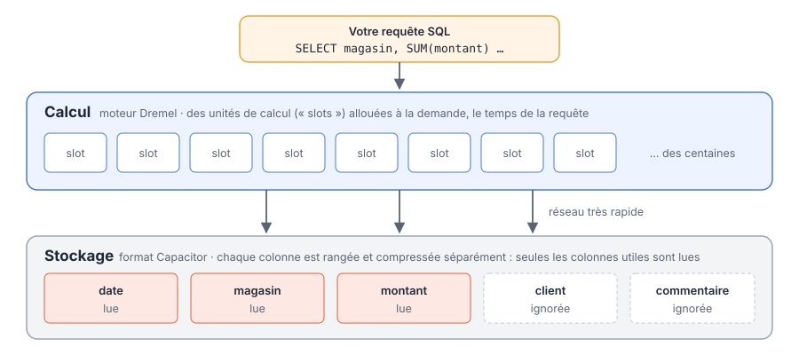
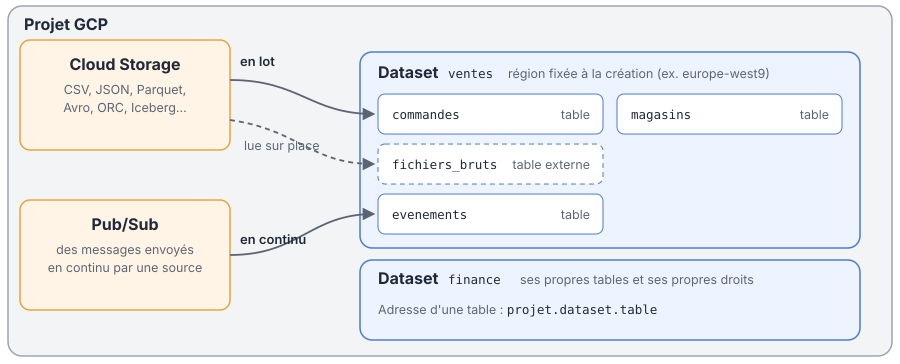
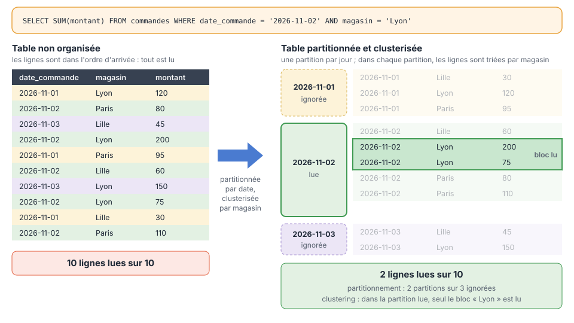

Les fichiers sont dans Cloud Storage. Il faut maintenant pouvoir les **interroger** : filtrer, joindre, agréger des millions de lignes en quelques secondes. Sur Google Cloud, c'est le rôle de **BigQuery**, l'entrepôt de données (*data warehouse*) de Google. Et bonne nouvelle : tout ce que vous avez appris en SQL s'y applique directement.

## Un entrepôt de données sans serveur

BigQuery est **serverless** (sans serveur, voir [Géré ou serverless ?](index.qmd#géré-ou-serverless)) : vous n'installez rien, vous ne choisissez pas de machine, vous ne gérez ni disque ni mise à jour. Vous écrivez du SQL, Google s'occupe du reste.

C'est une grande différence avec la page sur les bases de données : avec PostgreSQL, quelqu'un doit installer et dimensionner un serveur. Avec BigQuery, la puissance s'adapte toute seule à chaque requête, qu'elle lise mille lignes ou mille milliards.

:::{.callout-note}
## Entrepôt, pas base transactionnelle
BigQuery est fait pour **analyser** : lire et agréger de gros volumes. Il n'est pas fait pour faire tourner une application qui modifie une ligne à la fois des milliers de fois par seconde. Pour ça, on garde une base transactionnelle classique, comme on l'a vu dans la page sur les bases de données.
:::

## Comment ça marche

Le secret de BigQuery tient en deux idées.

**1. Le stockage et le calcul sont séparés.** Les données sont stockées d'un côté, et la puissance de calcul est empruntée de l'autre, uniquement le temps de la requête. On paie donc le stockage et le calcul séparément, et on n'a jamais une machine qui tourne pour rien.

**2. Le stockage est en colonnes.** Une base classique range les données **ligne par ligne**. BigQuery les range **colonne par colonne**, dans un format appelé **Capacitor**. Quand une requête n'utilise que trois colonnes sur cinquante, BigQuery ne lit que ces trois colonnes.

{fig-alt="Schéma de l'architecture de BigQuery : le calcul, réparti sur des slots, lit uniquement les colonnes utiles dans le stockage en colonnes" width="100%"}

Côté calcul, le moteur s'appelle **Dremel** : il découpe chaque requête en petites tâches, réparties sur des centaines d'unités de calcul appelées **slots**, qui travaillent en parallèle puis rassemblent leurs résultats. C'est ce qui permet de parcourir des téraoctets en quelques secondes.

:::{.callout-tip collapse="true"}
## Pour aller plus loin : les briques internes de Google
BigQuery s'appuie sur plusieurs technologies internes de Google : **Colossus** pour le stockage distribué, **Dremel** pour l'exécution des requêtes, **Jupiter**, un réseau interne très rapide qui rend possible la séparation du stockage et du calcul, et **Borg** pour répartir les machines. Google les décrit dans l'article [*BigQuery under the hood*](https://cloud.google.com/blog/products/bigquery/bigquery-under-the-hood), et le format de stockage dans [*Inside Capacitor*](https://cloud.google.com/blog/products/bigquery/inside-capacitor-bigquerys-next-generation-columnar-storage-format).
:::

## Combien ça coûte ?

C'est **la** question à se poser avec BigQuery, parce que la facturation est très différente d'une base classique :

- **le stockage** est facturé selon le volume de données conservées ;
- **les requêtes** sont facturées, par défaut, selon le **volume de données lues** (on dit « scannées »), quel que soit le nombre de lignes renvoyées. C'est le modèle **à la demande** (*on-demand*).

Conséquence directe : **une requête qui lit 1 To coûte mille fois plus qu'une requête qui lit 1 Go**, même si les deux renvoient une seule ligne. Tout l'art d'utiliser BigQuery consiste donc à **lire le moins de données possible**. C'est ce que permettent le stockage en colonnes, le partitionnement et le clustering.

:::{.callout-note}
## L'autre modèle : la capacité réservée
Les entreprises qui lancent beaucoup de requêtes peuvent plutôt **réserver** un nombre de slots, payés à l'heure, quel que soit le volume lu. C'est plus prévisible pour un gros budget. Dans ce cours, nous restons sur le modèle à la demande.
:::

## Projets, datasets et tables

BigQuery s'organise en trois niveaux :

- le **projet GCP**, comme pour Cloud Storage ;
- les **datasets**, qui regroupent des tables, un peu comme un **schéma** dans PostgreSQL. Chaque dataset a ses propres droits, et sa **région est choisie à la création et ne peut plus être changée** ;
- les **tables**, qu'on désigne par leur adresse complète : `projet.dataset.table`.

{fig-alt="Schéma : un projet contient des datasets et des tables ; les données arrivent depuis Cloud Storage en lot ou par table externe, et depuis Pub/Sub en continu" width="100%"}

:::{.callout-warning}
## Choisissez la région du dataset avec soin
Une requête ne peut pas joindre des tables situées dans des régions différentes, et BigQuery ne peut charger directement que des fichiers situés au même endroit que le dataset. Placez donc vos datasets **dans la même région que vos buckets** : `europe-west9` (Paris) avec un bucket à Paris, par exemple.
:::

## Faire entrer les données

### Le chargement en lot depuis Cloud Storage

C'est la méthode la plus courante : on dépose des fichiers dans un bucket, puis on les charge dans une table. BigQuery lit la plupart des formats : CSV, JSON, **Parquet**, Avro, ORC…

```sql
LOAD DATA INTO ventes.commandes
FROM FILES (
  format = 'PARQUET',
  uris = ['gs://ventes-brut-286bdf/2026/11/*.parquet']
);
```

L'étoile `*` charge tous les fichiers dont le nom correspond. Le même chargement est possible en ligne de commande avec `bq load`, ou depuis Python.

### Les tables externes : lire les fichiers sur place

On peut aussi **ne pas charger** les données : une **table externe** pointe vers des fichiers qui restent dans Cloud Storage, et BigQuery les lit au moment de la requête.

```sql
CREATE EXTERNAL TABLE ventes.fichiers_bruts
OPTIONS (
  format = 'PARQUET',
  uris = ['gs://ventes-brut-286bdf/2026/*.parquet']
);
```

C'est pratique pour explorer des fichiers sans les dupliquer, ou pour interroger des données gérées par d'autres outils. BigQuery sait aussi lire des tables au format **Apache Iceberg**, un format ouvert de tables sur stockage objet, au cœur de l'approche *lakehouse*. En contrepartie, les requêtes sont plus lentes qu'avec une table « native ».

### Le flux continu (*streaming*)

Quand les données arrivent en permanence (des capteurs, des clics, des passages en caisse), on les envoie au fil de l'eau. Le chemin le plus simple passe par **Pub/Sub**, le service de messagerie de Google Cloud : une source y publie des messages, et un **abonnement BigQuery** les écrit directement dans une table, sans programme intermédiaire.

:::{.callout-tip}
## Lot ou flux continu ?
La plupart des analyses n'ont pas besoin de données à la seconde près : un chargement par heure ou par nuit suffit, et c'est plus simple. Ne passez au flux continu que si un vrai besoin métier l'exige, comme une alerte en temps réel.
:::

## Partitionnement et clustering : lire moins pour payer moins

Puisqu'on paie les données lues, il faut organiser les tables pour que BigQuery puisse **ignorer** tout ce qui ne sert pas à la requête. Deux outils s'y emploient, et ils se combinent.

{fig-alt="Schéma : une table non organisée oblige à lire toutes les lignes ; une fois partitionnée par date et clusterisée par magasin, la requête ne lit qu'une partition puis un seul bloc" width="100%"}

### Le partitionnement : découper la table

**Partitionner**, c'est découper physiquement la table en morceaux, le plus souvent **par date** : une partition par jour, par mois ou par année. Quand une requête filtre sur la colonne de partitionnement, BigQuery ne lit **que les partitions concernées** et ignore les autres.

On peut partitionner selon :

- une colonne de **date ou d'horodatage** (le cas le plus courant) ;
- la **date d'arrivée** des données dans BigQuery ;
- des **tranches d'entiers** (par exemple, un identifiant de magasin de 1 à 100, par tranches de 10).

### Le clustering : trier chaque partition

**Clusteriser**, c'est **trier** les données de chaque partition selon une à quatre colonnes, par exemple le magasin puis la catégorie de produit. Les lignes d'un même magasin se retrouvent alors regroupées dans les mêmes **blocs** de stockage. BigQuery sait quelles valeurs contient chaque bloc : quand une requête filtre sur `magasin = 'Lyon'`, il saute tous les blocs qui ne peuvent pas contenir Lyon.

BigQuery entretient ce tri tout seul : au fur et à mesure que de nouvelles données arrivent, il les retrie en arrière-plan, sans frais supplémentaires.

### En pratique

Les deux se déclarent à la création de la table :

```sql
CREATE TABLE ventes.commandes (
  id_commande STRING,
  date_commande DATE,
  magasin STRING,
  categorie STRING,
  montant NUMERIC
)
PARTITION BY date_commande
CLUSTER BY magasin, categorie
OPTIONS (require_partition_filter = TRUE);
```

L'option `require_partition_filter` **refuse** toute requête qui ne filtre pas sur la date : impossible de lire toute la table par mégarde.

| | Partitionnement | Clustering |
|---|---|---|
| Ce qu'il fait | découpe la table en morceaux | trie les données dans chaque morceau |
| Sur quelles colonnes | une seule (date, horodatage ou entier) | jusqu'à quatre |
| Idéal pour | les filtres sur une période | les filtres sur des colonnes souvent utilisées (magasin, client, catégorie) |
| Estimation du coût avant la requête | précise | approximative |

:::{.callout-warning}
## Filtrer directement sur la colonne de partitionnement
Le partitionnement ne sert que si BigQuery comprend votre filtre **avant** de lancer la requête. Filtrez directement sur la colonne, avec des valeurs fixes :

```sql
WHERE date_commande BETWEEN '2026-11-01' AND '2026-11-30'   -- ✅ seules les partitions de novembre sont lues
```

Un filtre calculé à partir d'une sous-requête, ou combiné avec `OR` à une autre colonne, oblige BigQuery à tout lire.
:::

## Les bons réflexes pour maîtriser les coûts

### Ne jamais faire `SELECT *`

Comme le stockage est en colonnes, chaque colonne demandée est lue et facturée. Un `SELECT *` lit **toutes** les colonnes, y compris celles dont vous n'avez pas besoin. Listez uniquement les colonnes utiles.

:::{.callout-warning}
## `LIMIT` ne fait pas baisser la facture
`SELECT * FROM commandes LIMIT 10` lit quand même toute la table (sauf sur une table clusterisée, où l'économie reste partielle) : `LIMIT` réduit le nombre de lignes **affichées**, pas les données **lues**. Pour jeter un œil aux données, utilisez plutôt l'onglet **Aperçu** de la console ou la commande `bq head` : c'est gratuit.
:::

### Estimer le coût avant de lancer la requête

Dans la console, BigQuery affiche en haut à droite de l'éditeur le volume que la requête **va lire**, avant même de l'exécuter. En ligne de commande, c'est l'option `--dry_run` :

```bash
bq query --use_legacy_sql=false --dry_run \
  'SELECT magasin, SUM(montant) FROM ventes.commandes
   WHERE date_commande = "2026-11-02" GROUP BY magasin'
```

La requête n'est pas exécutée, donc pas facturée : BigQuery indique seulement combien d'octets elle traiterait.

### Poser des limites

- **Par requête** : l'option **octets facturés maximum** (*maximum bytes billed*) fait échouer, sans frais, toute requête qui dépasserait le volume fixé.
  ```bash
  bq query --use_legacy_sql=false --maximum_bytes_billed=1000000000 '...'   # 1 Go maximum
  ```
- **Par jour** : des **quotas personnalisés** limitent le volume total qu'un projet ou un utilisateur peut lire chaque jour. Une fois le quota atteint, les requêtes sont refusées jusqu'au lendemain.
- **Pour le projet** : un **budget avec alertes** dans la facturation Google Cloud, pour être prévenu avant la mauvaise surprise.

:::{.callout-important}
## Dès le premier jour sur un projet
Mettez en place un quota quotidien et une alerte de budget **avant** de donner accès à BigQuery à une équipe. Une seule requête mal écrite sur une très grosse table peut coûter cher, et il est beaucoup plus simple de prévenir que d'expliquer la facture.
:::


### Réutiliser plutôt que recalculer

#### Le cache des résultats

BigQuery garde le résultat de chaque requête pendant **environ 24 heures**. Si vous relancez **exactement la même requête**, il renvoie ce résultat sans relire les tables : c'est **gratuit**, et quasi instantané. Dans la console, la ligne *Bytes processed* affiche alors 0 B, et la requête est marquée comme venant du cache.

Le cache n'est utilisé que si :

- le texte de la requête est **identique au caractère près** : un espace, un retour à la ligne ou un commentaire ajouté suffisent à le rater ;
- les tables lues **n'ont pas changé** depuis ;
- la requête ne contient pas de fonction dont le résultat change à chaque appel, comme `CURRENT_DATE()` ou `CURRENT_TIMESTAMP()` ;
- le résultat n'est pas écrit dans une table de destination.

:::{.callout-tip}
## Un piège fréquent
`WHERE date_commande = CURRENT_DATE()` empêche tout cache, même si vous relancez la requête dix fois dans la journée. Si un tableau de bord rejoue souvent la même requête, écrivez la date en dur (ou passez-la en paramètre) pour qu'il puisse profiter du cache.
:::

#### Une CTE ne fait pas économiser

On pourrait croire qu'une CTE (`WITH ...`) calcule un résultat une fois pour toutes, qu'on réutiliserait ensuite. Ce n'est pas le cas : Google précise que les CTE servent à la **lisibilité, pas à la performance**. BigQuery ne garde pas leur résultat, et une CTE utilisée à plusieurs endroits d'une requête **peut être recalculée à chaque fois**. Le cache ne s'applique pas non plus à une CTE seule : il porte toujours sur une requête entière.

#### Les tables temporaires

Pour réutiliser un résultat coûteux, on l'enregistre dans une **table temporaire**. Dans une requête à plusieurs instructions, la grosse lecture n'est faite et facturée qu'une seule fois, puis les analyses suivantes ne lisent que la petite table :

```sql
-- 1. La grosse requête : lue et facturée une seule fois
CREATE TEMP TABLE ventes_novembre AS
SELECT magasin, categorie, montant
FROM ventes.commandes
WHERE date_commande BETWEEN '2026-11-01' AND '2026-11-30';

-- 2. Les analyses suivantes ne lisent que la table temporaire
SELECT magasin, SUM(montant) AS ca FROM ventes_novembre GROUP BY magasin;
SELECT categorie, AVG(montant) AS panier_moyen FROM ventes_novembre GROUP BY categorie;
```

La table temporaire disparaît automatiquement à la fin de la requête.

#### Les tables intermédiaires et les vues matérialisées

Quand un même résultat sert **d'un jour à l'autre**, ou à plusieurs personnes :

- on l'enregistre dans une **table intermédiaire**, recalculée régulièrement. C'est exactement ce que fait dbt avec la couche intermédiaire : elle est calculée une fois, puis tous les marts la lisent ;
- ou on crée une **vue matérialisée** : BigQuery stocke son résultat et le tient à jour quand les données sources changent.

| Besoin | Solution |
|---|---|
| Relancer exactement la même requête | Le cache, automatique et gratuit pendant environ 24 heures |
| Réutiliser un résultat dans la même requête | Une table temporaire (`CREATE TEMP TABLE`) |
| Réutiliser un résultat d'un jour à l'autre | Une table intermédiaire (avec dbt, par exemple) ou une vue matérialisée |
| Rendre une requête plus lisible | Une CTE, mais elle ne fait rien gagner |

### 🧠 À vous de réfléchir

La table `ventes.commandes` contient trois ans de données. Elle est partitionnée par `date_commande` et clusterisée par `magasin`. Classez ces requêtes de la plus coûteuse à la moins coûteuse.

```sql
-- A
SELECT * FROM ventes.commandes WHERE date_commande = '2026-11-02';

-- B
SELECT magasin, montant FROM ventes.commandes
WHERE date_commande = '2026-11-02' AND magasin = 'Lyon';

-- C
SELECT magasin, montant FROM ventes.commandes LIMIT 100;

-- D
SELECT magasin, montant FROM ventes.commandes WHERE date_commande = '2026-11-02';
```

:::{.callout-tip collapse="true"}
## 💡 Voir la solution

**C > A > D > B**

- **C** est la plus coûteuse : aucun filtre sur la date, donc **toutes** les partitions des trois ans sont lues. Le `LIMIT` ne change presque rien. Avec `require_partition_filter`, elle serait d'ailleurs refusée.
- **A** ne lit qu'une partition (un jour), mais **toutes les colonnes** de ce jour.
- **D** lit la même partition, mais seulement deux colonnes.
- **B** lit la même partition et les deux mêmes colonnes, et grâce au clustering, seulement les blocs de Lyon.
:::

## Bien plus qu'un entrepôt

BigQuery ne sert pas qu'à lancer des requêtes SQL. Quelques possibilités à connaître :

- **BigQuery ML** : entraîner et utiliser des modèles de machine learning (régression, classification, séries temporelles, segmentation…) **directement en SQL**, sans sortir les données de l'entrepôt.
  ```sql
  CREATE MODEL ventes.prevision_ca
  OPTIONS (model_type = 'ARIMA_PLUS', time_series_timestamp_col = 'jour', time_series_data_col = 'ca')
  AS SELECT jour, ca FROM ventes.ca_journalier;
  ```
- **Des fonctions d'IA générative** : appeler des modèles Gemini depuis une requête SQL, par exemple pour classer des commentaires clients.
- **Des données géographiques** (`GEOGRAPHY`), la **recherche vectorielle**, des données semi-structurées (`JSON`) et imbriquées.
- **Des données publiques** : des centaines de jeux de données ouverts, interrogeables directement (dataset `bigquery-public-data`).
- **Les outils de visualisation**, comme Looker Studio, qui se branchent directement sur BigQuery.
- **Python** : la bibliothèque `google-cloud-bigquery` renvoie le résultat d'une requête dans un DataFrame pandas, et **dbt** sait transformer les données directement dans BigQuery.

:::{.callout-note}
## Revenir dans le passé
BigQuery conserve l'historique des tables pendant quelques jours (le *time travel*, 7 jours par défaut) : une table supprimée ou modifiée par erreur peut être restaurée, ou interrogée telle qu'elle était à un instant donné avec `FOR SYSTEM_TIME AS OF`.
:::

## Ressources

- [Documentation de BigQuery](https://docs.cloud.google.com/bigquery/docs) : la référence officielle.
- [Les tables partitionnées](https://docs.cloud.google.com/bigquery/docs/partitioned-tables) et [les tables clusterisées](https://docs.cloud.google.com/bigquery/docs/clustered-tables) : le détail du fonctionnement.
- [Estimer et maîtriser les coûts](https://docs.cloud.google.com/bigquery/docs/best-practices-costs) : toutes les bonnes pratiques officielles.
- [Interroger une table partitionnée](https://docs.cloud.google.com/bigquery/docs/querying-partitioned-tables) : les filtres qui permettent d'ignorer des partitions.
- [*BigQuery under the hood*](https://cloud.google.com/blog/products/bigquery/bigquery-under-the-hood) : l'architecture interne, expliquée par Google.
- [Utiliser les résultats en cache](https://docs.cloud.google.com/bigquery/docs/cached-results) : le fonctionnement du cache et tous les cas où il ne s'applique pas.
- [Optimiser le calcul des requêtes](https://docs.cloud.google.com/bigquery/docs/best-practices-performance-compute) : les bonnes pratiques officielles, dont le passage sur les CTE et les tables temporaires.

:::{.callout-important}
## À retenir
- BigQuery est un **entrepôt de données sans serveur** : on écrit du SQL, Google gère toute l'infrastructure.
- **Stockage et calcul sont séparés**, et le stockage est **en colonnes** : seules les colonnes utilisées sont lues.
- Par défaut, on paie le **volume de données lues** par chaque requête, pas le nombre de lignes renvoyées.
- Un projet contient des **datasets** (région fixée à la création) qui contiennent des **tables** : `projet.dataset.table`.
- Les données arrivent surtout **en lot depuis Cloud Storage** ; les **tables externes** lisent les fichiers sur place ; **Pub/Sub** permet le flux continu.
- **Partitionner** (par date) permet d'ignorer des morceaux entiers de la table ; **clusteriser** trie chaque partition pour sauter des blocs. On filtre directement sur ces colonnes.
- Jamais de `SELECT *`, `LIMIT` ne réduit pas le coût, on vérifie avec **`--dry_run`**, et on pose des **limites** (octets maximum, quotas, alertes de budget).
- Relancer **exactement** la même requête est gratuit grâce au **cache** ; une CTE, elle, n'est jamais gardée en mémoire : pour réutiliser un résultat, passez par une **table temporaire** ou intermédiaire.
:::
